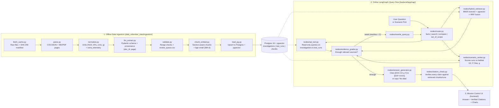

# EMBER System & RAG Architecture

EMBER implements the **Flame in Freefall — Data & RAG Architecture** ("Structured facts in, cited answers out"), separating offline data ingestion (Squad 1) from online grounded query routing and verification (Squad 2) and interactive visualization (Squad 3).

---

## Diagram-to-Code Mapping

### 1. Offline Data Ingestion (`data_ml/ember_data/ingestion/`)
| Diagram Box | File | Responsibility |
|---|---|---|
| **Fetch & cache** | [fetch_cache.py](file:///Users/dulnithliyanage/Academics/PyroTensor/EMBER/data_ml/ember_data/ingestion/fetch_cache.py) | Copies raw files into `data_ml/.cache/raw/` and writes SHA-256 checksums to `manifest.json`. |
| **Parse** | [parse.py](file:///Users/dulnithliyanage/Academics/PyroTensor/EMBER/data_ml/ember_data/ingestion/parse.py) | Reads CSV/JSON matrices, page-marked Markdown, and PDFs (via PyMuPDF). |
| **Normalize** | [normalize.py](file:///Users/dulnithliyanage/Academics/PyroTensor/EMBER/data_ml/ember_data/ingestion/normalize.py) + [column_map.yaml](file:///Users/dulnithliyanage/Academics/PyroTensor/EMBER/data_ml/ember_data/ingestion/adapters/column_map.yaml) | Converts `psia -> kPa`, `ft/min -> cm/s`, `O2 fraction -> %`, `"ug" -> 0.0g`, and packs unmapped columns into `extra_telemetry`. |
| **LLM extraction** | [llm_extract.py](file:///Users/dulnithliyanage/Academics/PyroTensor/EMBER/data_ml/ember_data/ingestion/llm_extract.py) | Extracts `Investigation` and `TestRun` records with `(source_doc_id, source_page)` provenance. |
| **Validate** | [validate.py](file:///Users/dulnithliyanage/Academics/PyroTensor/EMBER/data_ml/ember_data/ingestion/validate.py) | Enforces `schema_v1.json` bounds, flags physics anomalies, and writes the top 15 flagged rows to `data_ml/review_queue.csv`. |
| **Chunk & embed** | [chunk_embed.py](file:///Users/dulnithliyanage/Academics/PyroTensor/EMBER/data_ml/ember_data/ingestion/chunk_embed.py) | Splits documents into section-aware chunks (never crossing page boundaries) and embeds with `BAAI/bge-small-en-v1.5` (384-dim). |
| **Postgres + pgvector** | [load_pg.py](file:///Users/dulnithliyanage/Academics/PyroTensor/EMBER/data_ml/ember_data/ingestion/load_pg.py) + [schema.sql](file:///Users/dulnithliyanage/Academics/PyroTensor/EMBER/backend/app/db/schema.sql) | Upserts `investigations`, `test_runs`, `telemetry`, and `chunks` (with HNSW vector index + GIN `tsvector` index). |

### 2. Online RAG Query Flow (`backend/app/rag/`)
| Diagram Box | File | Responsibility |
|---|---|---|
| **LangGraph router** | [router.py](file:///Users/dulnithliyanage/Academics/PyroTensor/EMBER/backend/app/rag/nodes/router.py) | Routes user question into `facts`, `search`, `compare`, or `out_of_scope`. |
| **SQL tool** | [sql_tool.py](file:///Users/dulnithliyanage/Academics/PyroTensor/EMBER/backend/app/rag/nodes/sql_tool.py) | Executes read-only structured queries against `investigations` and `test_runs` using `ember_ro`. |
| **Hybrid retriever** | [hybrid_retriever.py](file:///Users/dulnithliyanage/Academics/PyroTensor/EMBER/backend/app/rag/nodes/hybrid_retriever.py) | Combines Postgres `ts_rank_cd` (BM25) + `pgvector` cosine distance via Reciprocal Rank Fusion (RRF). |
| **Scenario ranker** | [scenario_ranker.py](file:///Users/dulnithliyanage/Academics/PyroTensor/EMBER/backend/app/rag/nodes/scenario_ranker.py) | Scores runs against habitat $(O_2\%, P_{\text{kPa}}, u_{\text{flow}}, g)$ by Similarity, Completeness, and Criticality. |
| **Evidence grader** | [evidence_grader.py](file:///Users/dulnithliyanage/Academics/PyroTensor/EMBER/backend/app/rag/nodes/evidence_grader.py) | Checks source count and term overlap; loops to `rewrite_query.py` (up to 2 times) when weak. |
| **Answer generator** | [answer_generator.py](file:///Users/dulnithliyanage/Academics/PyroTensor/EMBER/backend/app/rag/nodes/answer_generator.py) | Generates claims ending in `[DOC-XX p.Y]` or `[EXP-XXXX]`, or outputs `"No data"` when unsupported. |
| **Citation check** | [citation_check.py](file:///Users/dulnithliyanage/Academics/PyroTensor/EMBER/backend/app/rag/nodes/citation_check.py) | Strips any sentence whose citation does not match a retrieved chunk or test run (`dropped_claims`). |
| **Evaluation** | [run_eval.py](file:///Users/dulnithliyanage/Academics/PyroTensor/EMBER/backend/eval/run_eval.py) | Runs `golden_set.jsonl` to verify citation accuracy and out-of-scope refusal. |
