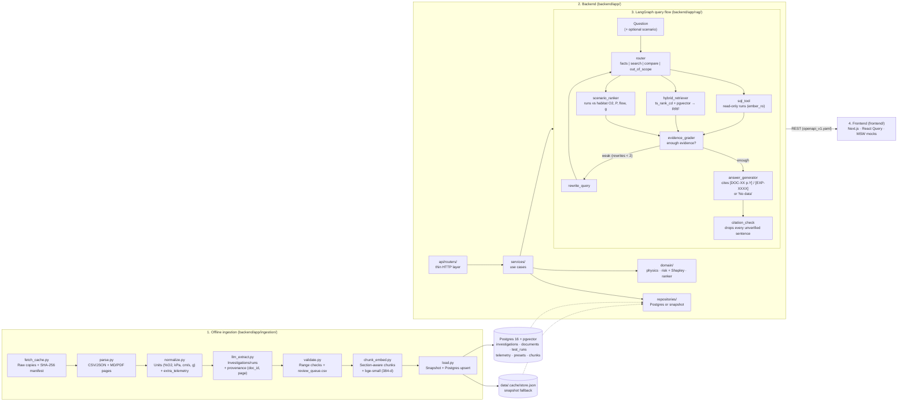

# EMBER System & RAG Architecture

EMBER follows **"structured facts in, cited answers out"**: an offline ingestion pipeline loads NASA test runs and
literature into Postgres + pgvector, the backend answers through deterministic domain code and a grounded LangGraph
RAG graph, and the frontend renders both. Backend and frontend are independent apps joined only by
[`contracts/openapi_v1.yaml`](../contracts/openapi_v1.yaml).

---

## Diagram-to-code map

### 1. Offline ingestion ([`backend/app/ingestion/`](../backend/app/ingestion/))
Run with `make seed` (proxy data in `backend/data/seed/`) or `python -m app.ingestion --source <dir>`.

| Stage | File | Responsibility |
|---|---|---|
| **Fetch & cache** | [fetch_cache.py](../backend/app/ingestion/stages/fetch_cache.py) | Copies raw files into `data/.cache/raw/` and records SHA-256 checksums in `manifest.json`. |
| **Parse** | [parse.py](../backend/app/ingestion/stages/parse.py) | Reads CSV/JSON run matrices, telemetry, presets, page-marked Markdown and PDFs. |
| **Normalize** | [normalize.py](../backend/app/ingestion/stages/normalize.py) + [column_map.yaml](../backend/app/ingestion/adapters/column_map.yaml) | Converts `psia → kPa`, `ft/min → cm/s`, `O2 fraction → %`, `"ug" → 0 g`; unmapped columns go into `extra_telemetry`. |
| **Extract** | [llm_extract.py](../backend/app/ingestion/stages/llm_extract.py) | Heuristic (default) or Gemini extraction of investigations and runs with `(source_doc_id, source_page)` provenance. |
| **Validate** | [validate.py](../backend/app/ingestion/stages/validate.py) | Enforces `schema_v1.json` bounds, flags physics anomalies, writes the 15 most-flagged rows to `data/.cache/review_queue.csv`. |
| **Chunk & embed** | [chunk_embed.py](../backend/app/ingestion/stages/chunk_embed.py) | Section-aware chunks that never cross a page, embedded with `BAAI/bge-small-en-v1.5` (384-d). |
| **Load** | [load.py](../backend/app/ingestion/stages/load.py) | Always writes the snapshot `data/.cache/store.json`; upserts everything into Postgres in one transaction when it is reachable. |

The schema is owned by Alembic: [`backend/alembic/versions/`](../backend/alembic/versions/) creates pgvector, the
core tables, `chunks` (HNSW cosine index + generated `tsvector` with GIN) and the read-only role `ember_ro`.

### 2. Backend layers ([`backend/app/`](../backend/app/))
| Layer | Path | Responsibility |
|---|---|---|
| **API** | [api/routers/](../backend/app/api/routers/) | One router per area (health, presets, cabin, experiments, telemetry, copilot). Parse → call service → return schema. |
| **Services** | [services/](../backend/app/services/) | Use cases; raise `AppError`s that render as `{"error": {code, message, details}}`. |
| **Domain** | [domain/](../backend/app/domain/) | Pure functions: [combustion physics](../backend/app/domain/physics/combustion.py), [fire-risk index](../backend/app/domain/risk/fire_risk.py) + [exact Shapley](../backend/app/domain/risk/shapley.py), [scenario ranker](../backend/app/domain/ranking/scenario_ranker.py). |
| **Repositories** | [repositories/](../backend/app/repositories/) | All reads/writes. Postgres repos, or snapshot repos when the DB is down (chosen per request in [api/deps.py](../backend/app/api/deps.py)). Hybrid search lives in [chunk_repo.py](../backend/app/repositories/chunk_repo.py). |
| **Schemas** | [schemas/](../backend/app/schemas/) | Pydantic models that mirror the contract; `make contract-check` diffs them against it both ways. |

### 3. RAG query flow ([`backend/app/rag/`](../backend/app/rag/))
| Node | File | Responsibility |
|---|---|---|
| **Router** | [router.py](../backend/app/rag/nodes/router.py) | Domain-keyword gate, then `facts`, `search`, `compare` or `out_of_scope`. |
| **SQL tool** | [sql_tool.py](../backend/app/rag/nodes/sql_tool.py) | Read-only lookups of runs by id or by program / material / regime / gravity filters. |
| **Hybrid retriever** | [hybrid_retriever.py](../backend/app/rag/nodes/hybrid_retriever.py) | Keyword (`ts_rank_cd`) + vector (`<=>` cosine) candidates fused with Reciprocal Rank Fusion. |
| **Scenario ranker** | [scenario_ranker.py](../backend/app/rag/nodes/scenario_ranker.py) | Ranks runs against the given or inferred habitat by similarity, completeness and criticality. |
| **Evidence grader** | [evidence_grader.py](../backend/app/rag/nodes/evidence_grader.py) | Decides `enough` vs `weak`; weak loops to [rewrite_query.py](../backend/app/rag/nodes/rewrite_query.py) at most twice. |
| **Answer generator** | [answer_generator.py](../backend/app/rag/nodes/answer_generator.py) | Every sentence ends in `[DOC-XX p.Y]` or `[EXP-XXXX]`; otherwise "No data". |
| **Citation check** | [citation_check.py](../backend/app/rag/nodes/citation_check.py) + [citations.py](../backend/app/rag/citations.py) | Splits sentences (bullet-, newline- and markdown-aware), drops any sentence without a citation that matches the evidence (`dropped_claims`). |
| **Evaluation** | [run_eval.py](../backend/eval/run_eval.py) + [thresholds.yaml](../backend/eval/thresholds.yaml) | 30-question golden set: supported accuracy ≥ 0.9, citation recall ≥ 0.8, zero leaked unverified claims. |

The LLM is pluggable ([llm/factory.py](../backend/app/llm/factory.py)): `heuristic` (default, no key) or `gemini`.

### 4. Frontend ([`frontend/src/`](../frontend/src/))
| Area | Path | Responsibility |
|---|---|---|
| **Routes** | [app/](../frontend/src/app/) | Server-component pages that set metadata and render one feature view. |
| **Features** | [features/](../frontend/src/features/) | cabin, experiments (ranking + telemetry), copilot, twin, overview, health, presets: api + React Query hooks + components. |
| **API client** | [lib/api/](../frontend/src/lib/api/) | The only place that calls `fetch`; types generated from the contract (`schema.d.ts`). |
| **Mocks** | [mocks/](../frontend/src/mocks/) | MSW handlers and a TypeScript port of the domain engine, loaded only in mock mode. |
| **Flame Twin** | [features/twin/](../frontend/src/features/twin/) | WebGL2 raymarched flame; display-only physics in `lib/flame-physics.ts`. |

**API mode** (`NEXT_PUBLIC_API_MODE`): `mock` answers every request in the browser (MOCK badge and banner);
`live` calls `NEXT_PUBLIC_API_URL`. A live failure shows an error state and the OFFLINE badge, never mock data.
